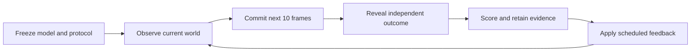

# WoMI-Bench

**World Model Index Benchmark**

An open evaluation framework for worlds that can be generated, reconstructed, remembered, edited and advanced through time.

Developed and maintained by **[Maxime Sebti](https://github.com/mxmsbt)**.

[Protocol](docs/protocol.md) · [Machine-readable specification](protocol/womi-bench-v0.1.0.json) · [Reporting contract](docs/reporting.md) · [Contributing](CONTRIBUTING.md) · [Citation](CITATION.cff)

## Why evaluate worlds?

A compelling frame answers what a scene looks like. A useful world model must also answer what is behind an object, what remains when the camera returns, what changes after an intervention, and what happens next.

WoMI-Bench asks whether those answers describe **one coherent world**. Its goal is to make progress in spatial intelligence measurable through controlled experiments, matched model comparisons and independently replayable evidence.

That matters for simulation, interactive creation, robotics and future vision-model training. Worlds with grounded geometry, state and dynamics can support controlled variation and supervision. Their value for training must ultimately be tested on held-out real observations and tasks.

## Five capabilities

| Capability | Central question | Evidence to retain |
| --- | --- | --- |
| **Generation** | Can a model create a world and follow requested viewpoints and content? | Inputs, camera paths, rendered sequences, quality and controllability measurements |
| **Reconstruction** | Does the recovered scene agree with observed geometry? | Calibrated observations, predicted geometry, independent targets and validity masks |
| **Persistence** | Does the same world survive revisits, occlusion and new observations? | Linked states, revisit sequences, identity and geometry consistency measurements |
| **Editing** | Does an intervention change its intended target while preserving the rest? | Parent/child states, edit requests, affected regions and subsequent views |
| **Dynamics** | Does the model predict the consequences of time and actions? | Observation prefixes, actions, forecast trajectories and independently grounded outcomes |

Every comparison also reports coverage, failures, uncertainty, latency, memory and cost. A geometry component and a complete interactive world engine belong in explicitly different comparison scopes.

## One framework, distinct measurements

WoMI-Bench combines three complementary forms of evidence:

1. **Established public evaluations.** Retain the names, versions and scoring definitions of upstream benchmarks, including [WorldScore](https://haoyi-duan.github.io/WorldScore/) for world generation and [Physics-IQ](https://github.com/google-deepmind/physics-IQ-benchmark) for physical video prediction. Add explicitly specified posed-reconstruction studies.
2. **Matched world-model comparisons.** Run compatible systems on the same frozen inputs, trajectories, interventions and declared resource budgets. Compare retained outputs under the same evaluator.
3. **Fresh prospective worlds.** Freeze the model first, then evaluate forecasts against independently generated or observed outcomes withheld from its runtime.

Results remain a capability profile. This specification defines **no cross-track aggregate or universal leaderboard score**: a strong render should not conceal failed geometry, memory or dynamics.

## Predict before reveal



The prospective track uses ten-frame forecast blocks. Predictions or failures must be committed before the corresponding outcomes are revealed. Observation-every-block, observation-every-ten-blocks and open-loop conditions are reported separately. Frame rate and physical time are explicit; ten frames does not imply real-time inference.

Ground truth comes from independently controlled simulator state or observed outcomes. A second learned model's prediction is not automatically ground truth. Cryptographic commitments make later changes detectable against a trusted anchor; they do not establish physical correctness or prevent every form of leakage.

## Scientific contract

- Freeze model versions, inputs, evaluator definitions, sample counts, feedback schedules and resource limits before a confirmatory run.
- Separate challenge discovery and metric calibration from independent confirmation worlds.
- Keep every assigned case in the coverage record; retain failed and interrupted attempts.
- Treat independent worlds or captures as the statistical units, accounting for correlated frames and repeated views.
- Publish paired uncertainty, failure analysis and compute alongside scores.
- Recompute metrics from retained raw predictions and targets on an independent host.
- Test shortcuts, distribution shift and agreement with held-out human or physical evidence.

See the [protocol](docs/protocol.md) and [reporting contract](docs/reporting.md) for the required study record.

## Public release

**v0.1.0 is the protocol and research-scope release.** It contains the benchmark definition, reporting requirements, citation metadata and attribution. It does not distribute an execution harness, model weights, evaluation datasets or benchmark results.

Versioned implementation and measurement releases must identify exactly which parts of this specification they execute. New metrics or aggregate formulas require an explicit version change and evidence supporting their interpretation.

## Attribution and citation

**WoMI-Bench** names Score Technologies' evaluation framework and protocol. Integrated benchmarks, datasets, models and evaluators retain their original names, authorship and licenses. Our framework does not transfer ownership of those contributions or imply endorsement by their authors. See [NOTICE](NOTICE).

Use [CITATION.cff](CITATION.cff) to cite this protocol release. Cite each upstream benchmark separately when reporting its measurements.

```bibtex
@misc{scoretechnologies2026womibench,
  author = {{Score Technologies}},
  title = {{WoMI-Bench}: World Model Index Benchmark},
  year = {2026},
  version = {0.1.0},
  howpublished = {Public protocol specification},
  url = {https://github.com/score-technologies/WoMI-Bench}
}
```

Original repository content is available under the [MIT License](LICENSE).
